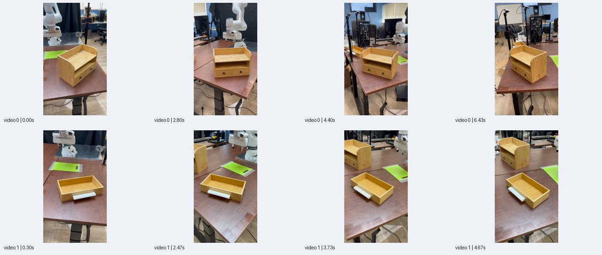
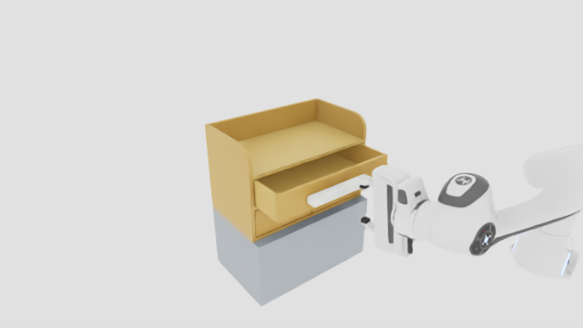

# Video to verified rollout

**Input:** [video 28](input/IMG_0028.mov), [video 29](input/IMG_0029.mov),
“one cabinet with three sliding drawers,” and “open the top drawer by 10 cm.”
**Output:** an articulated cabinet, a six-stage SUN Program and a verified rollout.

| Sampled input frames | Simulator output |
|---|---|
|  |  |

The [recorded result](output/verification.json) passes all six stages, the MPC
solver checks and the physical drawer-travel check. See the [handoff record](output/handoff.json).
The dimensions and mass are estimates from the supplied object views.

## Run

Complete [CPU and Isaac installation](../../docs/INSTALL.md), then run from the
repository root in the CPU agent environment:

```bash
export KUAFU_ISAAC_PYTHON=/absolute/path/to/isaac-environment/bin/python
export KUAFU_AGENT_DEVICE=cuda:0
python examples/01_video_to_rollout/run.py --run-id my-cabinet
```

This reproduction uses the bundled scene and agent-program proposals. The run
still prepares the actual videos, builds the asset, observes the scene, submits
the program and physically verifies it through the public agent tools.
For fresh proposals, connect [your agent](../../docs/USAGE.md) to the same tools.

## Inspect or continue

```bash
kuafu handoff status my-cabinet --verify
python examples/01_video_to_rollout/run.py --resume --run-id my-cabinet
```

Open `$KUAFU_ARTIFACT_ROOT/runs/my-cabinet/` for every request, response, artifact
hash and job log. The verification job saves `output/final_table_cam_0.png`,
`output/verification.json` and `accepted/program/`.
