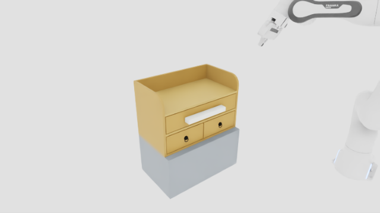
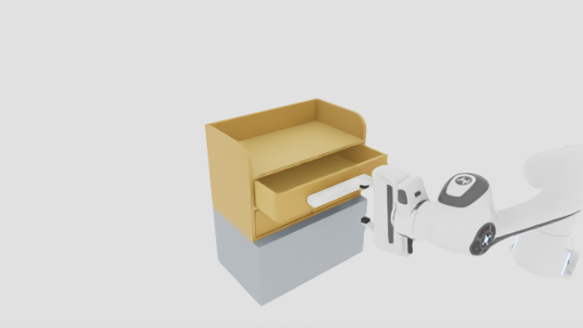

# SUN Program to MPC rollout

**Input:** a [cabinet recipe](../../assets/recipes/0028_0029.articulated.scene.json)
and its [six-stage SUN Program](../../resources/learned_programs/generated-video28-29-cabinet/2026-10-17_19-34-23/program).
**Output:** a solver trace, physical verification report and rollout image.

| Initial scene | Recorded output |
|---|---|
|  |  |

The [task](input/task.json) requests 10 cm travel with 1 cm tolerance and at most
5 mm motion in either lower drawer. Read the [measured result](output/verification.json).

## Run

Complete [installation](../../docs/INSTALL.md). From the repository root, build
the prepared asset in the CPU environment:

```bash
kuafu assets build-scene assets/recipes/0028_0029.articulated.scene.json \
  --mass-kg 2.5 --estimated-mass --out examples/cabinet
```

Then execute the program in the Isaac environment:

```bash
timeout --signal=TERM --kill-after=5s 900 \
  python -m kuafu verify-drawer --headless --enable_cameras --device cuda:0 \
  --asset "$KUAFU_ARTIFACT_ROOT/examples/cabinet" \
  --mode replay \
  --program resources/learned_programs/generated-video28-29-cabinet/2026-10-17_19-34-23/program \
  --output examples/cabinet-replay
```

Inspect `$KUAFU_ARTIFACT_ROOT/examples/cabinet-replay/verification.json`,
`mpc_solves.json`, `trajectory.json` and `final_table_cam_0.png`. The command
allows 15 minutes; `progress.json` identifies the last active stage and operation
if execution stops early.
Choose a fresh output directory for another replay. To revise the program with
an agent and retain every attempt, use the [full handoff example](../01_video_to_rollout/README.md).
