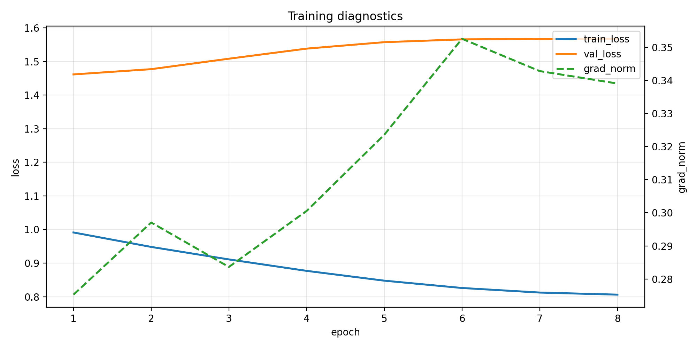

# Recorded demonstrations to a BC policy

**Input:** [four successful Kinova Stack-2 demonstrations](input/demonstrations.hdf5)
and a [small training configuration](input/train.yaml).
**Output:** an eight-epoch [BC checkpoint](output/final.pth),
[validation metrics](output/metrics.json) and training curves.



The sample contains 484 transitions, 31-dimensional state observations and
11-dimensional absolute end-effector actions. Training and validation split by
whole demonstration. See [data provenance](input/provenance.json).

## Run

From the repository root:

```bash
python -m pip install -e ".[bc]"
python examples/03_demonstrations_to_policy/run.py --output examples/my-bc-run
```

The script copies the input into the run directory, trains on CPU and saves
`train.yaml`, `train.log`, `training/<timestamp>/checkpoints/final.pth`,
`curves.npz` and `training_diagnostics.png` under `KUAFU_ARTIFACT_ROOT`.
Use this small example to check loading, normalization, training and export.
For task performance, collect a full dataset and run the policy through the
[simulator evaluation workflow](../../docs/WORKFLOWS.md).
