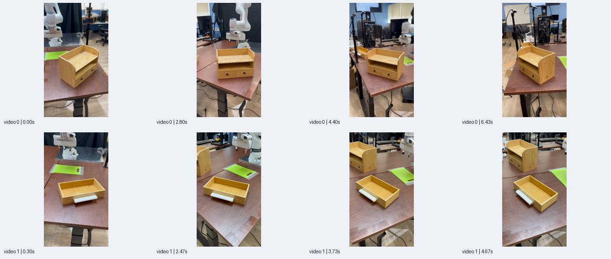
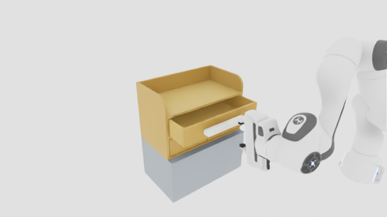

# Video to policy, end-to-end

**Input:** [videos 28 and 29](../01_video_to_rollout/input), a cabinet description,
and “Open the top drawer by 10 cm.” [Task settings](input/task.json) reference the
same cabinet and SUN Program throughout the workflow.

**Output:** an articulated cabinet with interaction frames and axes, a physically
verified SUN Program, newly collected demonstrations, a BC checkpoint and a
measured policy rollout. The example replays saved agent proposals through the
public tools. Connect [your own agent](../../docs/AGENT_INTERFACE.md) to generate
proposals for new inputs.

| Video input | Policy rollout |
|---|---|
|  |  |

The [recorded run](output/manifest.json) collected **4 demonstrations / 693
transitions**, fitted on three episodes and validated on one. The policy
completed all six SUN stages and opened the drawer **9.39 cm**, within the
10±1 cm target, in **172 control steps** with **0 MPC solves** during evaluation.
This check uses the original cabinet pose and evaluation seed 46.

Inspect the [dataset](output/demonstrations.hdf5), [policy](output/policy.pth),
[collection results](output/collection.json), [training results](output/training.json)
and [physical evaluation](output/evaluation.json). `$RUN` in recorded provenance
refers to the source run directory.

## Run

Complete [installation](../../docs/INSTALL.md): install `[assets,agents]` in your
agent environment and `[all]` in your Isaac environment. Then run:

```bash
export KUAFU_ISAAC_PYTHON=/absolute/path/to/isaac-environment/bin/python
export KUAFU_ARTIFACT_ROOT=/absolute/path/to/KuafuArtifacts
export KUAFU_AGENT_JOB_TIMEOUT=3600
python examples/04_video_to_policy/run.py --run-id my-cabinet-policy
```

The runner prepares the video frames, builds the asset, inspects the scene,
submits and verifies the saved SUN Program, collects four MPC demonstrations,
fits a nearest-neighbor BC policy, and evaluates it in the same scene. Training
and validation use separate episodes. The SUN Program retains stage transitions;
the policy matches measured robot/object configurations to training states in
the current stage and supplies their demonstrated joint targets.

## Inspect the handoffs

All attempts live in `$KUAFU_ARTIFACT_ROOT/runs/my-cabinet-policy/`:

| Step | Output inside its attempt's job directory |
|---|---|
| Verify program | `accepted/program/`, `output/verification.json` |
| Collect | `output/episode_*/`, `output/demonstrations.hdf5` |
| Train BC | `output/report.json`, `output/policy.pth`; MLP runs also keep `output/stage_*/` |
| Evaluate policy | `output/rollout/verification.json`, `output/rollout/final_table_cam_0.png` |

`video_to_policy.json` at the run root links the dataset, checkpoint and rollout.
`policy_passed` reports whether measured travel and every SUN stage passed.
The command exits with code 1 when the policy misses its target. Its evaluation
report and image remain available for the next repair attempt.

Resume completed, unchanged steps with:

```bash
python examples/04_video_to_policy/run.py --run-id my-cabinet-policy --resume
kuafu handoff status my-cabinet-policy --verify
```

Change `--episodes` to recollect. Use `--method mlp --epochs 600` to fit one neural
BC policy per SUN stage on the retained collection. Inspect its physical result
when choosing the data and training budget. Upstream revisions mark older downstream results stale. See the
[run layout](../../docs/PIPELINE.md) for request, response and log files.
